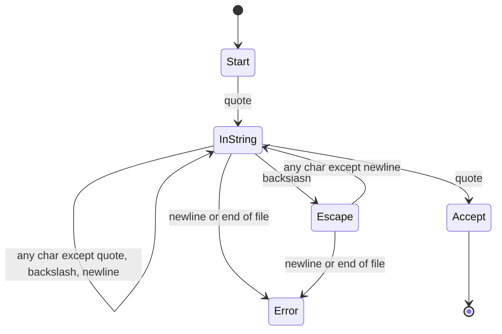
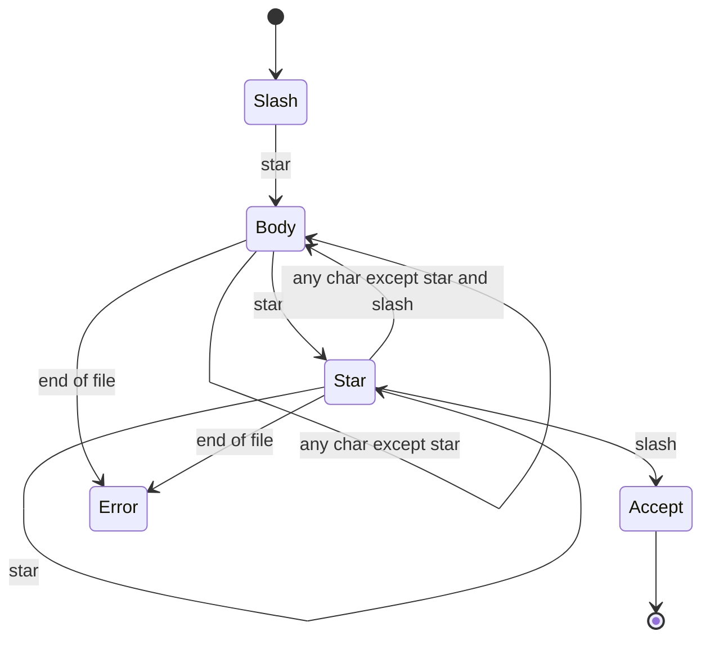

# قواعد لغوی B-Minor

Lexer پروژه دست‌نویسه و به‌صورت یه DFA کار می‌کنه. اینجا نوشتم هر توکن چه شکلی داره و وقتی چند قاعده با هم جور می‌شن، کدوم انتخاب می‌شه.

## توکن‌ها

| نوع توکن | عبارت منظم | مثال |
|----------|------------|------|
| `KEYWORD` | یکی از کلمه‌های زیر | `if`، `return`، `integer` |
| `IDENT` | `[A-Za-z_][A-Za-z0-9_]*` | `n`، `_count`، `x1` |
| `INT_LIT` | `[0-9]+` | `0`، `42` |
| `BOOL_LIT` | `true \| false` | `true` |
| `STRING_LIT` | `"([^"\\\n] \| \\[^\n])*"` | `"hello\n"` |
| `CHAR_LIT` | `'([^'\\\n] \| \\[^\n])'` | `'a'`، `'\n'` |
| `OP` | `++ \| -- \| <= \| >= \| == \| != \| && \| \|\| \| [-+*/%^!<>]` | `+`، `<=`، `&&` |
| `ASSIGN` | `=` | `=` |
| `LPAREN RPAREN LBRACE RBRACE LBRACKET RBRACKET SEMI COLON COMMA` | `( ) { } [ ] ; : ,` | هرکدوم یه توکن |
| `LINE_COMMENT` | `//[^\n]*` | `// text` |
| `BLOCK_COMMENT` | `/\*([^*] \| \*+[^*/])*\*+/` | `/* text */` |
| `WHITESPACE` | `[ \t\r\n\f\v]+` | |
| `INVALID` | هر چیزی که به هیچ‌کدوم نخوره | `@` |

کلمه‌های کلیدی (۱۴ تا):
`array auto boolean char else for function if integer print return string void while`

`true` و `false` کلیدواژه حساب نمی‌شن و نوع `BOOL_LIT` دارن.

توی رشته و کاراکتر، بعد از `\` هر کاراکتری (جز خط جدید) مجازه و با `\` یه جفت حساب می‌شه. برای همین `"a\"b"` یه رشته‌ی کامله.

## وقتی چند قاعده جور می‌شن

**طولانی‌ترین تطبیق.** Lexer همیشه بلندترین چیزی رو که بشه خوند برمی‌داره:

- `<=` یه توکنه، نه `<` و `=`. همین‌طور `==`.
- `a+++b` می‌شه `a`، `++`، `+`، `b`.
- `//x` یه کامنته، چون از `/` بلندتره.
- `12abc` می‌شه `12` و `abc`، چون هر توکن بلندترین تطبیق خودش رو می‌گیره.

**کلیدواژه یا شناسه.** عبارت منظم شناسه کلیدواژه‌ها رو هم می‌پذیره (مثلاً `return`). برای همین اول کل کلمه رو می‌خونیم و بعد نگاه می‌کنیم توی جدول کلیدواژه‌ها هست یا نه. اگه بود `KEYWORD` (یا `BOOL_LIT` برای `true` و `false`)، وگرنه `IDENT`. پس `return` کلیدواژه‌ست ولی `returned` و `return1` شناسه‌ان.

**کامنت یا تقسیم.** بعد از `/` اگه `/` یا `*` بیاد کامنته، وگرنه عملگر تقسیم.

## عدد منفی

عدد توی Lexer علامت نداره. `-` همیشه یه توکن `OP` ـه و Parser تصمیم می‌گیره یگانی باشه یا دودویی. اگه `-1` یه توکن بود، `n-1` غلط به `n` و `-1` شکسته می‌شد.

## خطاها

Lexer هیچ‌وقت نمی‌ایسته. برای هر مشکل یه توکن `INVALID` می‌سازه، پیام خطا با موقعیتش رو ثبت می‌کنه و از همون‌جا ادامه می‌ده.

| مشکل | چی توی `INVALID` میاد | پیام |
|------|----------------------|------|
| کاراکتر ناشناخته (`@`، `#`، `$` و ...) | همون یه کاراکتر (کاراکتر UTF-8 کامل) | `invalid character '@'` |
| `&` یا `\|` تنها | همون یه کاراکتر | `invalid character '&'` |
| رشته‌ی بسته‌نشده `"abc` | تا آخر همون خط | `unterminated string literal` |
| کاراکتر خراب `'ab'` | از `'` تا جایی که خونده شد | `malformed or unterminated character literal` |
| کاراکتر خالی `''` | هر دو `'` | `empty character literal` |
| کامنت بلوکی بسته‌نشده | از `/*` تا آخر فایل | `unterminated block comment` |

رشته نمی‌تونه چند خطی باشه: اگه به `\n` برسیم و `"` پایانی نباشه، رشته بسته نشده.

## موقعیت توکن‌ها

هر توکن نام فایل، شماره‌ی خط و شماره‌ی ستونِ اولین کاراکترش رو داره. شماره‌گذاری از ۱ شروع می‌شه و ستون بر حسب بایته.

فاصله‌ها و کامنت‌ها هم توکن می‌شن. Parser نادیده‌شون می‌گیره، ولی رنگ‌آمیز بهشون نیاز داره که خروجی دقیقاً همون کد اصلی باشه.

## پیاده‌سازی

هر دسته توکن یه تابع اسکن کوچیک داره که در واقع یه DFA ـه. دو تا از پیچیده‌ترها:

رشته:

کامنت بلوکی:

